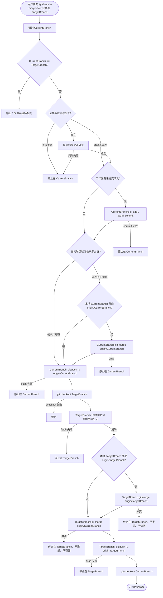

# Git 分支合并流程

## 功能与用法（中文说明）

### 功能说明

本 Skill 用于把你在仓库里**当前所在分支**上的改动，按固定顺序同步到**另一个分支**（目标分支），并推送到远端。流程概括如下。

**阶段一：在 `CurrentBranch` 上处理本地与远端**

1. 自动识别**当前分支**，并校验 `CurrentBranch` 与 `TargetBranch` **不相同**（相同则直接停止）。
2. **查询远端是否有来源分支**。存在时显式抓取，只刷新 `origin/<CurrentBranch>`；确认不存在时跳过抓取和对齐，允许首次推送。查询或抓取失败则停止。
3. 若有未提交改动则提交（在已掌握远端状态后再固化本地变动）。
4. 若远端存在来源分支且本地 `CurrentBranch` 落后于刚刷新的 `origin/<CurrentBranch>`，先合入该引用；冲突则**停在 `CurrentBranch`**。
5. `git push` 把当前分支推送到远端；阶段二会重新刷新来源引用。

**阶段二：在 `TargetBranch` 上合并并推送**

6. 切换到**目标分支**。
7. **显式抓取来源和目标分支**，刷新 `origin/<CurrentBranch>` 和 `origin/<TargetBranch>`，不依赖仓库默认的抓取范围。任一分支抓取失败则停止；成功后，若本地落后于 `origin/<TargetBranch>`，先对齐。
8. 将 **`origin/<CurrentBranch>`** 合并进目标分支（**不以本地 `CurrentBranch` 为合并来源**）。
9. **合并成功**：推送目标分支，切回当前分支并汇报。
10. **合并冲突**（任一 merge 阶段）：立即停止；留在冲突所在分支，目标分支冲突时不切回当前分支。

其中「当前分支」与「目标分支」分别对应 `CurrentBranch` 与 `TargetBranch`。完整分步流程见下方「完整流程」。

### 完整流程

#### 流程图



#### 分步说明

| 步骤 | 所在分支 | Git 操作 | 说明 | 失败时 |
|------|----------|----------|------|--------|
| 0 | `CurrentBranch` | 识别 `CurrentBranch`；校验 `CurrentBranch` ≠ `TargetBranch` | 来源与目标相同时无意义，直接停止 | 停止 |
| 1 | `CurrentBranch` | `git ls-remote --exit-code` 查询来源；存在时显式抓取该分支 | 只刷新 `origin/<CurrentBranch>`；确认远端未创建该分支时跳过抓取 | 查询或抓取失败时停止在 `CurrentBranch` |
| 2 | `CurrentBranch` | `git add .` + `git commit`（仅当有改动） | 先确认远端状态再固化本地变动；提交说明用中文 | 停止在 `CurrentBranch` |
| 3a | `CurrentBranch` | 跳过 | 已确认远端没有该分支，不用本地可能残留的 `origin/<CurrentBranch>` 做对齐 | — |
| 3b | `CurrentBranch` | `git merge origin/CurrentBranch` | 本地**落后**远端时对齐 | 冲突则停止在 `CurrentBranch` |
| 3c | `CurrentBranch` | 跳过 | 本地已与 `origin/CurrentBranch` 一致或领先 | — |
| 4 | `CurrentBranch` | `git push -u origin CurrentBranch` | 推送对齐后的当前分支，或首次创建远端来源分支 | 停止在 `CurrentBranch` |
| 5 | `TargetBranch` | `git checkout TargetBranch` | 切换到目标分支 | 停止 |
| 6 | `TargetBranch` | `git fetch --refmap= origin` 并传入两个显式映射（见命令流程） | 就近刷新 `origin/<CurrentBranch>` 和 `origin/<TargetBranch>`；远端任一分支不存在也视为抓取失败 | 停止在 `TargetBranch`，不合并、不推送 |
| 7a | `TargetBranch` | `git merge origin/TargetBranch` | 本地目标分支**落后**远端时对齐 | 冲突则停止在 `TargetBranch`，不推送、不切回 |
| 7b | `TargetBranch` | 跳过 | 本地目标已与 `origin/TargetBranch` 一致或领先 | — |
| 8 | `TargetBranch` | `git merge origin/CurrentBranch` | **始终**以远端跟踪分支为合并来源 | 冲突则停止在 `TargetBranch`，不推送、不切回 |
| 9 | `TargetBranch` | `git push -u origin TargetBranch` | 推送合并后的目标分支 | 停止在 `TargetBranch` |
| 10 | `CurrentBranch` | `git checkout CurrentBranch` | 切回来源分支 | — |
| 11 | — | 汇报 | 按「输出要求」输出 | — |

#### 为什么在提交前检查并抓取来源

- 查询和抓取不修改工作区、暂存区或当前分支指针，因此可以在提交前先确认远端状态。
- 顺序：**查询来源 → 抓取（远端存在时）→ 提交（如有改动）→ 对齐（若落后）→ 推送**。

#### 为什么两次 fetch，且第二次放在阶段二

- **阶段一 fetch**：仅刷新来源分支，用于推送前对齐；远端没有该分支时允许首次推送。
- **阶段二 fetch**：在 `checkout TargetBranch` 后、对齐前显式刷新两个引用。即使 `remote.origin.fetch` 只覆盖来源分支，本次也会抓取目标分支，无需修改仓库配置。
- 若阶段一推送后有人更新了远端来源分支，第 8 步以阶段二抓取到的 `origin/CurrentBranch` 为准。

#### 分支与引用关系

```text
阶段一（CurrentBranch）：
  查询并抓取来源分支                    ← 远端没有该分支时跳过抓取和对齐
       ↓
  [commit 本地改动（如有）]
       ↓
  CurrentBranch ◀──merge── origin/CurrentBranch   （仅当本地落后时）
       ↓
  git push ──▶ 远端 CurrentBranch

阶段二（TargetBranch）：
  checkout TargetBranch
       ↓
  显式抓取来源和目标分支                ← 刷新两个 origin 引用，失败即停止
       ↓
  TargetBranch ◀──merge── origin/TargetBranch     （仅当本地落后时）
       ↓
  TargetBranch ◀──merge── origin/CurrentBranch    （合并来源，非本地 CurrentBranch）
       ↓
  git push ──▶ origin/TargetBranch
       ↓
  checkout CurrentBranch
```

#### 两条路径

**成功路径**

```text
CurrentBranch: 查询来源 → [抓取来源（若远端存在）] → [commit] → [对齐 origin/CurrentBranch（若落后）] → push
    → checkout TargetBranch
    → 显式抓取来源和目标分支（刷新两个 origin 引用）
    → [对齐 origin/TargetBranch（若落后）]
    → merge origin/CurrentBranch
    → push TargetBranch
    → checkout CurrentBranch
    → 汇报
```

**冲突路径**

```text
CurrentBranch 阶段冲突（对齐 origin/CurrentBranch）：
  → 立即停止，留在 CurrentBranch，不 checkout TargetBranch

TargetBranch 阶段冲突（对齐 origin/TargetBranch 或 merge origin/CurrentBranch）：
  → 立即停止，留在 TargetBranch，不 push TargetBranch，不切回 CurrentBranch
```

冲突阶段标识：

| 标识 | 所在分支 | 含义 |
|------|----------|------|
| `align-origin-current` | `CurrentBranch` | 对齐 `origin/CurrentBranch` 时冲突 |
| `align-origin-target` | `TargetBranch` | 对齐 `origin/TargetBranch` 时冲突 |
| `merge-origin-current` | `TargetBranch` | 合并 `origin/CurrentBranch` 时冲突 |

#### 禁止操作

| 操作 | 原因 |
|------|------|
| 来源与目标分支相同仍继续 | 无意义，且 `merge origin/自身` 可能污染分支 |
| 在 `CurrentBranch` 上 `git pull origin TargetBranch` | 方向反了：会把目标分支合进功能分支 |
| `git pull` 代替显式 `git fetch` + `git merge` | `pull.rebase` 等配置会改变行为 |
| 未检查远端就对齐或 push；或已知远端有分支却未刷新引用 | 可能用陈旧引用做判断 |
| 在 `TargetBranch` 上 `git merge CurrentBranch`（本地） | 应用 `git merge origin/CurrentBranch` |
| push / fetch 失败后继续后续步骤 | 状态不可靠，必须立即停止 |

### 使用方法

1. 在目标 Git 仓库里，先 `git checkout` 到你希望作为「来源」的分支（即日常开发分支），保证要交付的代码都在这个分支上。
2. 在对话里发送触发语句，把末尾换成真实的**目标分支**名即可：

```text
/git-branch-merge-flow 合并到<目标分支>
```

示例：把当前分支合并进 `dev`：

```text
/git-branch-merge-flow 合并到dev
```

3. 由 Agent 按本文件中的步骤执行命令；你只需在冲突时按提示解决冲突后，再自行决定后续提交或推送。

### 使用注意

- 默认远端为 `origin`，分支名与本地一致；若你使用其它 remote 或特殊分支策略，需在对话里额外说明。
- **来源与目标必须不同**：`CurrentBranch` 与 `TargetBranch` 相同时直接停止，不执行任何 push / merge。
- 若当前分支存在未提交改动，需要自动提交时，提交说明默认使用**中文**，并尽量贴合实际改动文件内容；不要只写笼统描述。
- 提交说明应避免机械化表达，不要写“将 A 分支合并到 B 分支”这类不自然表述。
- 若用户明确给出提交说明格式或文案，优先按用户要求执行。
- 在 Windows PowerShell 中，避免用管道把中文直接传给 `git commit -F -`；请使用 UTF-8（无 BOM）临时文件传入 `-F`，以降低中文提交信息出现乱码（如 `??`）的概率。
- `git push` 或 `git fetch` 失败时应立即停止，不继续后续步骤。
- **提交前先查询并抓取来源**：`git ls-remote --exit-code` 返回 `2` 表示没有匹配的远端分支；其他非零退出码视为查询失败。远端存在来源分支时，必须抓取成功后才能继续。
- **CurrentBranch 推送前对齐**：本地落后于刚刷新的 `origin/CurrentBranch` 时，先合入远端来源分支。
- **TargetBranch 合并来源始终是 `origin/CurrentBranch`**：切到目标分支后显式刷新两个远端跟踪引用，再对齐并合并。

### 合并前 fetch 与对齐说明

- 两次抓取都用 `--refmap=` 和显式映射。阶段一只刷新来源，阶段二刷新来源和目标。
- `Invoke-AlignWithRemote` 仅在相应引用抓取成功后调用：落后则合并，一致或领先则跳过。阶段一确认远端没有来源分支时不调用此函数；阶段二任一分支抓取失败都停止。
- **禁止**在 **CurrentBranch** 上执行 `git pull origin <TargetBranch>`（方向反了）。
- **禁止**使用 `git pull` 代替显式 `git fetch` + `git merge`。
- 在 **TargetBranch** 上执行 `git merge origin/<CurrentBranch>`，**不要**执行 `git merge <CurrentBranch>`（本地分支）。

## 命令流程（Windows PowerShell）

严格按照以下命令顺序执行，仅替换目标分支占位符：

```powershell
# 只需输入目标分支，当前分支自动识别。
$TargetBranch = "target-branch-name"

$CurrentBranch = git rev-parse --abbrev-ref HEAD
$OriginCurrentRef = "origin/$CurrentBranch"

# 校验：来源分支与目标分支必须不同。
if ($CurrentBranch -eq $TargetBranch) {
  Write-Host "CurrentBranch 与 TargetBranch 相同（$CurrentBranch），无需合并。停止。"
  exit 1
}

# 动态识别仓库标识，用于最终汇报。
$OriginUrl = git remote get-url origin 2>$null
$RepoIdentifier = ""
if ($LASTEXITCODE -eq 0 -and $OriginUrl) {
  $NormalizedUrl = $OriginUrl.Trim() -replace '\\', '/'
  $RepoIdentifier = ($NormalizedUrl -split '/')[-1]
  if ($RepoIdentifier.EndsWith(".git")) {
    $RepoIdentifier = $RepoIdentifier.Substring(0, $RepoIdentifier.Length - 4)
  }
}
if (-not $RepoIdentifier) {
  $GitTopLevel = git rev-parse --show-toplevel
  $RepoIdentifier = Split-Path $GitTopLevel -Leaf
}

$ConflictPhase = ""

# 共享函数：当前检出的 $Branch 落后于 origin/$Branch 时执行对齐。
# 通过 $script:AlignStatus（none / merged / skipped）与 $script:AlignDetail 返回结果。
# 合并冲突时设置 $script:ConflictPhase = $ConflictLabel，以退出码 1 停止并留在 $Branch。
function Invoke-AlignWithRemote {
  param(
    [Parameter(Mandatory = $true)][string]$Branch,
    [Parameter(Mandatory = $true)][string]$ConflictLabel
  )

  $remoteRef = "refs/remotes/origin/$Branch"
  git show-ref --verify --quiet $remoteRef
  if ($LASTEXITCODE -ne 0) {
    Write-Host "未找到已抓取的引用 $remoteRef，停止对齐。"
    exit 1
  }

  $behind = [int](git rev-list --count "$Branch..$remoteRef")
  $ahead = [int](git rev-list --count "$remoteRef..$Branch")

  if ($behind -gt 0) {
    git merge $remoteRef
    if ($LASTEXITCODE -ne 0) {
      $script:ConflictPhase = $ConflictLabel
      Write-Host "对齐 $Branch 与 $remoteRef 时发生合并冲突，留在 $Branch 并停止。"
      exit 1
    }
    $script:AlignStatus = "merged"
    $script:AlignDetail = "已 merge $remoteRef（落后 $behind 个提交）"
  } else {
    $script:AlignStatus = "none"
    if ($ahead -gt 0) {
      $script:AlignDetail = "本地领先 origin $ahead 个提交，无需对齐"
    } else {
      $script:AlignDetail = "已与 origin 一致"
    }
  }
}

# 阶段一：CurrentBranch — fetch、提交、对齐、推送。

# 提交前查询来源；只有远端没有匹配分支时，才跳过抓取和对齐。
$CurrentHeadRef = "refs/heads/$CurrentBranch"
$null = git ls-remote --exit-code --refs origin $CurrentHeadRef
$SourceLookupExit = $LASTEXITCODE
if ($SourceLookupExit -eq 0) {
  git fetch --no-tags --no-prune --refmap= origin "+${CurrentHeadRef}:refs/remotes/origin/${CurrentBranch}"
  if ($LASTEXITCODE -ne 0) { exit 1 }
} elseif ($SourceLookupExit -ne 2) {
  Write-Host "查询远端来源分支 $CurrentBranch 失败，停止。"
  exit 1
}

$HadNewCommit = $false
if ((git status --porcelain).Length -gt 0) {
  $CommitMessage = "完善文档说明与流程细节"
  git add .
  $CommitMsgFile = Join-Path (git rev-parse --git-dir) "commit-msg-utf8.txt"
  $Utf8NoBom = New-Object System.Text.UTF8Encoding $false
  [System.IO.File]::WriteAllText($CommitMsgFile, $CommitMessage, $Utf8NoBom)
  git commit -F $CommitMsgFile
  if ($LASTEXITCODE -ne 0) { exit 1 }
  Remove-Item -Force $CommitMsgFile
  $HadNewCommit = $true
}

if ($SourceLookupExit -eq 0) {
  Invoke-AlignWithRemote -Branch $CurrentBranch -ConflictLabel "align-origin-current"
  $CurrentAligned = $AlignStatus
  $CurrentAlignDetail = $AlignDetail
} else {
  $CurrentAligned = "skipped"
  $CurrentAlignDetail = "远端尚无来源分支，跳过对齐"
}

git push -u origin $CurrentBranch
if ($LASTEXITCODE -ne 0) { exit 1 }

# 阶段二：TargetBranch — 切换、fetch、对齐、合并 origin/CurrentBranch、推送。

git checkout $TargetBranch
if ($LASTEXITCODE -ne 0) { exit 1 }

# 显式刷新两个引用（例如 feature/login 合入 dev），避免默认只抓取功能分支。
# --refmap= 仅影响本次抓取；任一远端分支不存在时停止，不使用旧引用继续对齐。
git fetch --refmap= origin `
  "+refs/heads/${CurrentBranch}:refs/remotes/origin/${CurrentBranch}" `
  "+refs/heads/${TargetBranch}:refs/remotes/origin/${TargetBranch}"
if ($LASTEXITCODE -ne 0) { exit 1 }

Invoke-AlignWithRemote -Branch $TargetBranch -ConflictLabel "align-origin-target"
$TargetAligned = $AlignStatus
$TargetAlignDetail = $AlignDetail

# 在 fetch 和对齐之后、合并之前记录 SHA，用于最终汇报。
$OriginCurrentSha = git rev-parse --short $OriginCurrentRef
$OriginTargetSha = ""
git rev-parse "origin/$TargetBranch" 2>$null
if ($LASTEXITCODE -eq 0) { $OriginTargetSha = git rev-parse --short "origin/$TargetBranch" }

# 将 origin/CurrentBranch 合入目标分支，不合并本地 CurrentBranch。
git merge $OriginCurrentRef
if ($LASTEXITCODE -ne 0) {
  $ConflictPhase = "merge-origin-current"
  Write-Host "将 $OriginCurrentRef 合入 $TargetBranch 时发生冲突，留在 $TargetBranch 并停止。"
  exit 1
}

git push -u origin $TargetBranch
if ($LASTEXITCODE -ne 0) { exit 1 }

git checkout $CurrentBranch
Write-Host "完成：已校验来源与目标不同；已对齐 $CurrentBranch（$CurrentAligned）并推送；已切换到 $TargetBranch，执行 fetch、对齐（$TargetAligned）、合并 $OriginCurrentRef 并推送；已切回 $CurrentBranch。"
Write-Host "涉及仓库：$RepoIdentifier"
```

## 输出要求

每次均须汇报：

- 识别出的**当前分支**与**目标分支**名称，以及二者不同的校验结果
- 当前分支在对齐前是否产生新提交
- **CurrentBranch** 的对齐状态（`none` / `merged` / `skipped`）及详情
- **CurrentBranch** 的推送状态
- fetch 状态（阶段一在当前分支，阶段二在目标分支）
- 实际作为合并来源的 `origin/<CurrentBranch>` 引用及短 SHA
- **TargetBranch** 的对齐状态（`none` / `merged` / `skipped`）及详情
- 功能分支合并状态（来源：`origin/<CurrentBranch>`）
- 流程结束后的所在分支
- 涉及仓库一行： `涉及仓库：\`<repo-identifier>\``

成功时按以下样式汇报：

```text
已按 /git-branch-merge-flow 合并到<目标分支> 执行完成，结果如下：

- 当前分支（CurrentBranch）：`<current-branch>`
- 目标分支（TargetBranch）：`<target-branch>`
- 当前分支是否先产生新提交：<是/否>
- 新提交：`<commit-sha>`（`<commit-message>`）（若无则写「无」）
- 阶段一 fetch（CurrentBranch）：<已刷新来源 | 远端尚无来源分支，已跳过>
- 当前分支对齐：<none | merged | skipped>（<CurrentAlignDetail>）
- 当前分支推送：成功
- 阶段二 fetch（切到 TargetBranch 后）：已刷新来源和目标（origin/<target> @ <sha>）
- 合并来源：`origin/<current-branch>` @ `<sha>`（非本地分支）
- 目标分支对齐：<none | merged | skipped>（<TargetAlignDetail>）
- 功能分支合并：成功（<fast-forward | merge commit>，`origin/<current-branch>` → `<target-branch>`）
- 最终所在分支：`<final-branch>`
- 涉及仓库：`<repo-identifier>`

已执行的关键动作：

- 已校验来源与目标分支不同
- 已查询远端来源分支；存在时显式刷新，再按需提交和对齐
- 已将 `<current-branch>` 推送到远端
- 已切换到 `<target-branch>` 并显式刷新来源和目标引用、对齐 `origin/<target-branch>`（若需要）
- 已合并 `origin/<current-branch>` 到 `<target-branch>`
- 已将 `<target-branch>` 推送到远端
- 已切回 `<current-branch>` 分支
```

发生冲突时，汇报必须明确说明：

- **停留分支**（`CurrentBranch` 或 `TargetBranch`）
- 若停留在 `TargetBranch`：未切回 `CurrentBranch`，未推送 `TargetBranch`
- 若停留在 `CurrentBranch`：未切换到 `TargetBranch`
- **冲突阶段**：`align-origin-current` / `align-origin-target` / `merge-origin-current`
- **冲突文件**：`<list>`

## 版本说明

- 当前生效版本： `1.5.4`
- 用户未指定版本时，默认使用当前最新的 `SKILL.md`。
- 历史快照应保存在仓库根目录的 `history/skills/git-branch-merge-flow/<version>.md`；不要放入可分发的 Skill 目录，也不要命名为 `SKILL.md`。
- `1.5.4`: 两阶段改用显式分支抓取，避免默认抓取范围导致远端跟踪引用过期；区分来源分支尚未发布与查询失败。
- `1.5.3`: 删除重复的英文执行说明，其余英文说明、注释和提示改为中文；保留原有结构、流程图、命令逻辑与输出模板。
- `1.5.2`: 将版本与来源治理字段迁入 `metadata`，兼容官方 SKILL.md 校验器；执行流程未变化。
- `1.5.1`: 历史快照迁移到仓库顶层 `history/`，并改用 `<version>.md` 文件名，避免使用侧复制 Skill 时携带历史版本或将其误识别为可安装 Skill。
- `1.5.0`: 相对 `1.4.0` 的整体升级——合并来源改为 `origin/<CurrentBranch>`（非本地分支）；`CurrentBranch` 与 `TargetBranch` 落后各自 `origin/*` 时统一对齐；`CurrentBranch` 采用「先 fetch 再 commit」顺序，push 后不再重复 fetch，第二次 fetch 放在阶段二切到目标分支之后；新增 `CurrentBranch != TargetBranch` 守卫；对齐逻辑抽取为共享函数 `Invoke-AlignWithRemote`；补全流程图与分步表。

## 提示语示例

```text
/git-branch-merge-flow 合并到<目标分支>

示例：
/git-branch-merge-flow 合并到release/yyy
```
